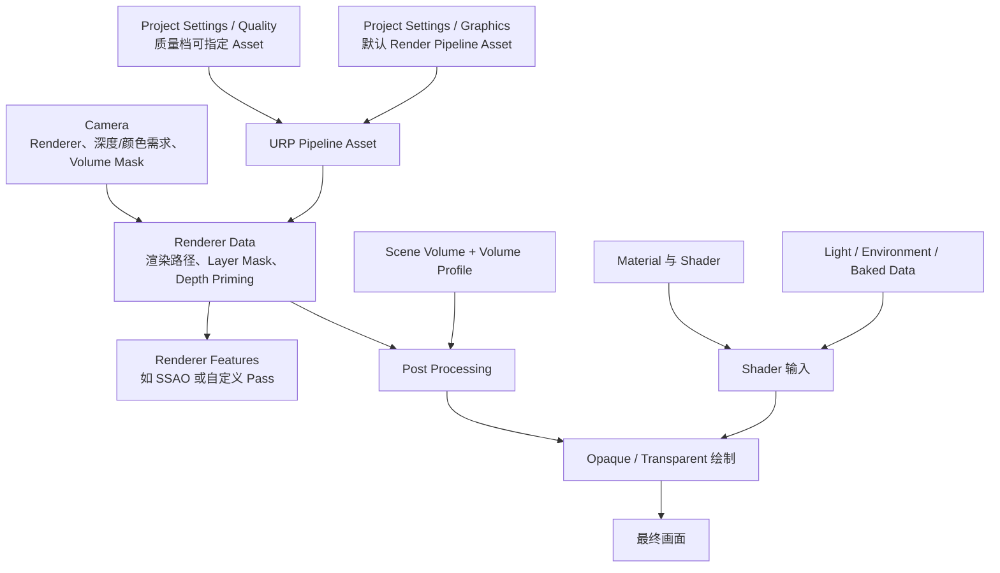

本章先讲一般关系，再标出与本项目 Unity 2022.1 / URP 13.1.9 相关的版本细节。

## Q：Built-in、SRP、URP 和 HDRP 是什么关系？

Unity 项目需要一套流程把场景变成屏幕图像。Built-in Render Pipeline 是 Unity 传统内置管线；SRP（Scriptable Render Pipeline，可编程渲染管线）是 Unity 提供的可编程框架；URP（Universal Render Pipeline）和 HDRP（High Definition Render Pipeline）是基于 SRP 的两套管线。

- **URP** 面向较广的平台和可扩展的性能配置。
- **HDRP** 面向较高端硬件与更丰富的高保真渲染功能。
- **Built-in** 使用传统管线的着色器接口与资源组织方式。

它们的功能、Shader 接口和 Renderer 配置并不完全相同。一个管线中的 Shader 不能假设换到另一条管线就能原样工作。选择时要看目标平台、画面要求、团队资源和项目阶段；中途换管线通常需要迁移材质与效果。

**版本提示：**功能对比随 Unity 与渲染管线包版本变化。本项目固定 Unity 2022.1.25f1、URP 13.1.9；涉及某个功能是否内置、Renderer 字段名称或 Shader Pass 行为时，以该项目版本为准。

## Q：URP 的配置分别在哪里？

Unity 的渲染配置不是一个单独的“管线开关”。项目设置选择管线 Asset，管线 Asset 再引用一个或多个 Renderer Data；Renderer Data 决定采用哪些渲染步骤和扩展功能；场景对象、相机、灯光、Volume 等向这些步骤提供输入或参数。

| Unity 对象 | 主要职责 | 可在 Inspector 中关注什么 |
| --- | --- | --- |
| Render Pipeline Asset | 选择渲染器并设置管线级能力 | 灯光模式、阴影支持、HDR、MSAA、渲染比例、深度/不透明纹理需求 |
| Renderer Data | 设置具体渲染器的绘制规则 | Forward/Deferred、Opaque/Transparent Layer Mask、Depth Priming、Renderer Features |
| Renderer Feature | 在 Renderer 执行序列中增加或配置某类处理 | 执行时机、筛选对象、输入数据、渲染目标 |
| Camera | 确定视角、剔除与相机级渲染选项 | Culling Mask、Renderer、Depth Texture、Opaque Texture、Volume Layer Mask |
| Light 与 Environment | 提供场景光照和环境输入 | Light 类型、实时/烘焙模式、阴影、环境光 |
| Material | 将 Shader 与具体参数、贴图绑定 | Shader、颜色、纹理、金属度、平滑度、Surface/Blend 等状态 |
| Volume 与 Profile | 保存并按相机/空间混合效果参数 | Global/Local、Layer、Priority、Blend、Profile 及各 Override |

URP Asset 可以有多份，例如性能、平衡和高保真配置；质量档可以选择不同 Asset。Renderer 则可以有不同配置并由管线 Asset 或 Camera 选择。改变一个 Asset 的参数可能影响所有引用它的相机与质量档，因此要先确认引用关系。

## Q：Renderer Feature 和 Pass 是什么？

这里有两个相似但不同的“Pass”用法：

1. **ShaderLab Pass** 是 Shader 内的一次绘制描述。它可以有自己的顶点/片元程序、`LightMode` 标签、Blend、深度和剔除状态。
2. **URP render pass** 是管线安排的一步工作，例如绘制不透明对象、生成深度/法线，或运行全屏后处理。

`LightMode` 标签帮助 URP 判断某个 ShaderLab Pass 是否适合当前管线步骤。Renderer Feature 则允许 Renderer 加入某些预构建或自定义的管线步骤，并定义它们的执行时机。一个 Shader 有一个颜色 Pass，不代表它自然就能生成深度、相机法线或阴影贴图。

典型关联：

| 管线步骤 | Shader 常见 Pass 标签/数据 | 读写目的 |
| --- | --- | --- |
| 前向不透明绘制 | `UniversalForward` 或 `UniversalForwardOnly` | 着色并写颜色/深度 |
| 深度预通道 | `DepthOnly` | 写深度供遮挡、深度纹理或后续处理使用 |
| 法线预通道 | `DepthNormals` / `DepthNormalsOnly` | 输出供屏幕效果采样的法线数据 |
| 光源阴影绘制 | `ShadowCaster` | 从光源方向写入阴影深度 |
| 全屏效果 | Fullscreen Shader/Material + Renderer Feature | 读取颜色、深度等缓冲并输出处理后的图像 |

实际可执行顺序不是所有项目都固定为同一条线：渲染路径、Renderer Feature 的注入点、相机栈、透明队列和平台能力都可能改变顺序或省略某些 Pass。使用 Unity Frame Debugger 可以观察当前相机实际执行的绘制事件与目标缓冲区。

>实际的渲染执行里面是一个图结构,可能要执行多个Render Pass. 每个Render Pass里面又有多个Shader Pass. 

## Q：Shader Graph 是“参数面板”吗？能否自己写 PBR？

Shader Graph 是 Shader 的一种可视化编写方式。它根据节点图生成 Shader 程序。图里选择 URP Lit 目标时，常见输出块描述表面属性，例如 Base Color、Normal、Metallic、Smoothness；URP Lit 光照模型使用这些输入来计算着色。图选择 URP Unlit 目标时，默认直接输出颜色，不自动采用标准 Lit 光照。

从简单到更可控有几种做法：

| 想达到的目标 | 合适的起点 | 还由谁负责 |
| --- | --- | --- |
| 贴图或纯色受标准灯光照亮 | Lit Graph / URP Lit 材质 | URP Lit 继续处理光照与支持的阴影等 |
| 自定义颜色、法线或金属度，但保留标准光照 | Lit Graph 节点或 Custom Function | URP Lit 仍执行标准光照模型 |
| 自己把简单光照值算成最终颜色 | Unlit Graph + 节点/Custom Function | 自己决定哪些光照、阴影、环境输入要支持 |
| 控制 Pass、渲染状态、顶点数据结构或更完整的自定义 BRDF | ShaderLab + HLSL | 自己实现并维护需要的管线接口 |

如果把已计算的最终光照颜色接到 Lit 的 Base Color，URP 仍可能继续对其执行 Lit 着色；如果目标是直接输出自己的最终颜色，一般从 Unlit 目标开始更清楚。Custom Function 可增加 HLSL 计算，但它本身不负责创建新的 Renderer Feature 或 ShaderLab Pass。

## Q：动态光、烘焙光、Probe 和阴影怎样进入 Shader？

通常不需要在材质面板逐个绑定场景灯。管线和 Renderer 按项目设置、场景灯光、对象范围与渲染路径准备可用数据；Lit Shader 使用相应输入。材质主要描述表面。

- **实时灯光**：每帧或按管线策略更新；URP 会按可见范围、灯光数量限制和渲染路径处理主灯与额外灯。
- **Lightmap**：提前把部分静态表面光照写入贴图。静态对象运行时采样这些烘焙数据。
- **Light Probe**：在空间中存储烘焙的间接光照样本，运行时插值，为动态对象近似间接漫反射。
- **Reflection Probe**：从场景某处采集立方体环境图，为反射表面提供环境信息；它不是完整的实时光线追踪。
- **实时 Shadow Map**：URP 组织从光源视角的阴影绘制；Shader 参与写入投影深度并在受光表面查询阴影。

灯光照亮表面的计算和实时阴影贴图生成是两笔不同的成本。增加实时阴影常增加额外的深度绘制；点光源覆盖多个方向，方向光可能采用级联。动态光并不等价于“每盏灯对每个像素做一条光线追踪”。

## Q：硬光/软光应该调后处理还是 Shader？

先调整灯光、材质和阴影，再用 Volume 做画面收尾。

- 想要阴影边缘锐利或柔和，检查 Light 的阴影类型、URP 阴影支持、贴图分辨率与过滤设置。
- 想让建筑空间层次更明显，调整主光方向、强度、环境光、材质粗糙度与阴影范围。纯色哑光材质可以先帮助观察几何结构。
- 想统一整体明暗、色彩和色调映射，使用 Volume 中的曝光、Color Adjustments、Tonemapping 等。
- 想改变表面对光的数学响应，例如卡通分段明暗、自定义 BRDF，再考虑自定义 Shader。

后处理改变最终图像，不会替代正确的入射光方向、投影几何或材质响应。SSAO 可辅助表现接触处，但不应把它当作主阴影或全局光照。

## Q：Volume 是什么？它是不是体积渲染？

`Volume` 是用于影响相机效果的场景组件。它引用 `Volume Profile` 资源；Profile 内保存 Tonemapping、Bloom、Vignette 等 Override 的开关和参数。Global Volume 可影响整个相机范围；Local Volume 可依据体积形状、Layer、Priority 与 Blend 距离影响附近相机区域。

Volume 是“效果参数如何作用于相机”的系统；它不等于云、雾或水这样的体积介质。某些体积雾功能会使用 Volume 参数，但真正的体积效果仍需要相应的渲染实现。另一个关键区分：本项目的 SSAO 是 Renderer Data 中的 Renderer Feature，不在 Volume Profile 内。

## Q：效果需要额外 Pass 时，谁来加？

先确认输入数据是否已经可用，再判断是否需要加新的工作步骤。

1. 只需当前物体的位置、法线、UV、贴图与灯光：通常改材质 Shader 就够。
2. 需要场景深度、已绘制的不透明颜色：启用相机对应纹理需求，并确认该纹理的格式与执行时机。
3. 需要给特殊物体重绘一次、输出自定义缓冲、生成反射相机纹理或做全屏处理：考虑 Renderer Feature/额外 Render Pass，以及负责调度的少量 C#。
4. 需要许多粒子、实例或网格由 GPU 大规模更新：可研究 Compute Shader、GPU Instancing 与间接绘制；它们解决的是数据并行计算/绘制提交问题，不等同于普通 Fragment Shader。

无需一开始“重写管线”。URP 已提供的深度、颜色、阴影与光照输入可被复用；扩展工作的核心是明确新增数据是什么、何时生成、谁读取、最后如何合成。

## 本章参考

- [Unity 2022.1 渲染管线类型与选择](https://docs.unity3d.com/cn/2022.1/Manual/render-pipelines.html)
- [Unity 2022.1 活动渲染管线 Asset 设置](https://docs.unity3d.com/ja/2022.1/Manual/srp-setting-render-pipeline-asset.html)
- [Unity 2022.1 渲染管线功能比较](https://docs.unity3d.com/ja/2022.1/Manual/render-pipelines-feature-comparison.html)
- [URP 13.1.9 Pipeline Asset](https://docs.unity3d.com/Packages/com.unity.render-pipelines.universal@13.1/manual/universalrp-asset.html)
- [URP 13.1.9 SSAO](https://docs.unity3d.com/Packages/com.unity.render-pipelines.universal@13.1/manual/post-processing-ssao.html)
- [URP 13.1.9 Renderer Feature](https://docs.unity3d.com/Packages/com.unity.render-pipelines.universal@13.1/manual/urp-renderer-feature.html)
- [URP 13.1.9 Volume](https://docs.unity3d.com/Packages/com.unity.render-pipelines.universal@13.1/manual/Volumes.html)
- [URP 13.1.9 Shader tags and Passes](https://docs.unity3d.com/Packages/com.unity.render-pipelines.universal@13.1/manual/urp-shaderlab-pass-tags.html)
- [Unity 2022.1 SubShader Tags / Queue](https://docs.unity3d.com/cn/2022.1/Manual/SL-SubShaderTags.html)
- [Unity 2022.1 ProjectSettings Render Pipeline Asset](https://docs.unity3d.com/ja/2022.1/Manual/srp-setting-render-pipeline-asset.html)
