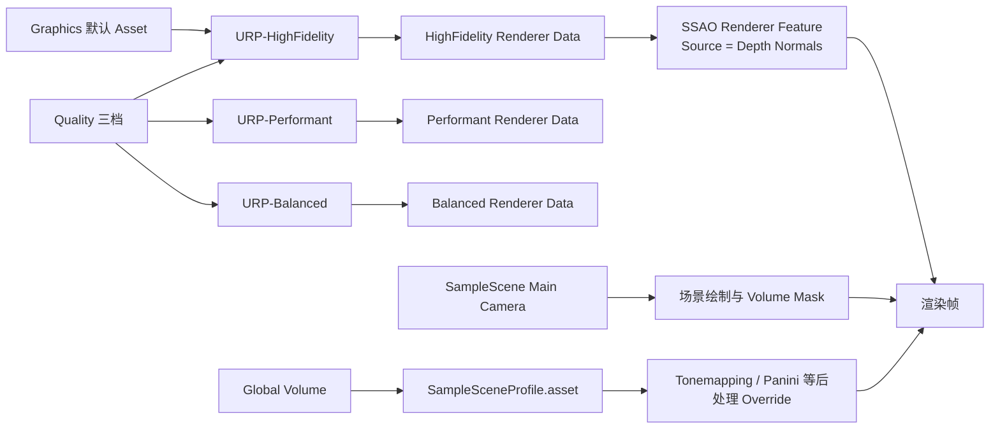
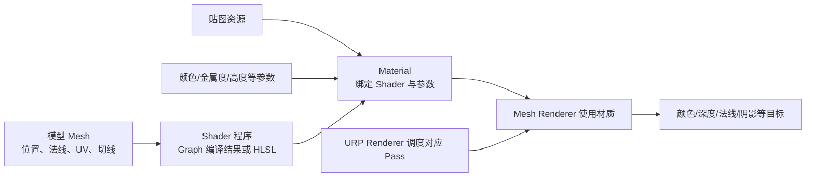

示例项目：`C:\Users\LEEL\Desktop\GameDesign\SRP Example`  
项目版本：Unity 2022.1.25f1；Universal RP 13.1.9

本章对应一个具体项目，解释设置资源如何连接、Shader Graph 与 HLSL Shader 怎样进入管线，以及材质和贴图如何供 Shader 使用。项目里的资产已归整到 `Assets/RenderingLearning/`；场景与全局 `Assets/Settings/` 保持 Unity 常见的位置。

## Q：Unity 项目的哪些文件共同组成渲染环境？

```text
SRP Example/
├─ Assets/
│  ├─ Scenes/SampleScene.unity
│  ├─ Settings/
│  │  ├─ URP-Performant.asset + Renderer
│  │  ├─ URP-Balanced.asset + Renderer
│  │  ├─ URP-HighFidelity.asset + Renderer
│  │  └─ SampleSceneProfile.asset
│  └─ RenderingLearning/
│     ├─ Shaders/Graph/
│     ├─ Shaders/HLSL/
│     ├─ Materials/
│     ├─ Textures/
│     ├─ Docs/
│     └─ Tools/
├─ Packages/manifest.json
└─ ProjectSettings/
```

| 文件/目录 | 在项目中的职责 | 本项目中的例子 |
| --- | --- | --- |
| `ProjectSettings/ProjectVersion.txt` | 固定打开项目所需的 Unity Editor 版本 | `2022.1.25f1` |
| `Packages/manifest.json` | 声明项目直接依赖的 Unity 包 | URP `13.1.9`、Shader Graph 随包提供 |
| `ProjectSettings/GraphicsSettings.asset` | 项目级渲染设置，包含默认管线 Asset 引用 | 默认引用 HighFidelity 管线 Asset |
| `ProjectSettings/QualitySettings.asset` | 质量档配置；档位可引用不同管线 Asset | Performant、Balanced、HighFidelity 三档 |
| `Assets/Settings/*URP*.asset` | 保存 URP 各档能力设置并引用 Renderer Data | 灯光、阴影、HDR、MSAA、深度等 |
| `Assets/Settings/*Renderer.asset` | 保存一个 Renderer 的绘制规则与 Features | HighFidelity Renderer 含 SSAO Feature |
| `Assets/Scenes/SampleScene.unity` | 场景对象、相机、灯光、Volume 和 Renderer 组件的实例 | Main Camera、Directional Light、Global Volume、Cube |
| `Assets/Settings/SampleSceneProfile.asset` | Volume Profile：相机效果的 Override 参数 | Tonemapping、Panini Projection 等 |
| `Assets/RenderingLearning/Shaders/` | Shader Graph 和代码 Shader | Lit、Unlit、视差贴图例子 |
| `Assets/RenderingLearning/Materials/` | Shader 与具体参数、贴图的绑定 | `M_02_CodeLit` 等材质 |
| `Assets/RenderingLearning/Textures/` | 颜色/高度等输入纹理 | Checker、Parallax Albedo、Parallax Height |
| `Assets/RenderingLearning/Tools/` | 生成学习资源的辅助脚本 | 视差示例贴图生成脚本 |

Unity 资产旁边的 `.meta` 文件保存 GUID。场景、Prefab、材质和管线资源通常通过 GUID 互相引用。移动或重命名资源时，应把 `.meta` 和资产一起移动；不能通过重新创建同名资源代替移动，否则 GUID 会改变、已有引用可能丢失。

## Q：Render Pipeline Asset、Renderer Data 与场景效果怎样连起来？

本项目的 Graphics 设置默认指向 HighFidelity；Quality Settings 另外提供 Performant、Balanced、HighFidelity 档。每个 URP Asset 引用对应 Renderer Data。当前 Quality 档可能覆盖默认 Graphics Asset，因此判断正在使用哪套配置时，要一起查看 Graphics 与 Quality。



HighFidelity URP Asset 启用了 HDR、4 倍 MSAA、主灯与额外灯、额外灯上限、阴影、4 级联和 Reflection Probe 混合等。Balanced 与 Performant 采用较低的阴影/抗锯齿预算。它们是不同画质取舍的配置，不是三条完全不同的管线。

HighFidelity Renderer Data 中挂有 SSAO Renderer Feature，来源设置为 Depth Normals，并采用 Depth Priming Auto。SSAO Feature 位于 Renderer 资源中，依赖当前相机可见的深度/法线数据；它不属于 Volume Profile。Volume Profile 保存的是相机效果参数。

场景中的 Global Volume 组件引用 `SampleSceneProfile.asset`，相机要把对应 Layer 纳入 Volume Layer Mask 才能读取该 Volume。当前 Profile 里 Tonemapping 与 Panini Projection 激活；Bloom、Vignette、Shadows/Midtones/Highlights 当前未激活。激活某个 Override 与其中某个参数是否覆盖，还要看该参数的 Override 状态。

## Q：Shader Graph、材质和模型之间的数据关系是什么？



- **Shader**定义如何使用输入数据，并声明支持哪些 Pass 和渲染状态。
- **Material**是某个 Shader 的一个具体实例：保存颜色、贴图、金属度、高度强度、队列等具体值。
- **Mesh**提供 Shader 所需的几何属性。视差例子需要 UV0 和有效切线；不带正确切线的模型无法正确把视线转换到切线空间。
- **Mesh Renderer**将 Mesh 和 Material 交给 Unity。相同 Shader 可被多个 Material 复用，不同材质可以使用不同贴图和参数。

## Q：示例 Shader 的输入、处理和输出分别是什么？

### 1. `Graph_Lit_TextureSample.shadergraph`：URP Lit Graph

这个原有 Graph 包含 Base Map、Smoothness、Emission 等表面描述节点，并采样纹理。连接到 URP Lit Target 后，Graph 提供表面属性；Lit 光照仍由 URP 标准着色处理。对应材质是 `M_LitGraph_TextureSample.mat`，Base Map 指向 Checker 贴图。场景 Cube 原有的材质引用通过 GUID 保留在这份材质上。

| 输入 | Graph 处理 | 输出与管线位置 |
| --- | --- | --- |
| Mesh UV、Base Map 纹理 | UV 采样纹理，再提供 Base Color 等表面输入 | 进入 Lit Shader 的片元阶段；URP Lit 随后结合灯光与表面数据算颜色 |
| 材质 Smoothness、Emission 等值 | 作为 Graph 属性或表面参数 | 改变 Lit 表面响应或发光输入 |

### 2. `Graph_Unlit_Texture.shadergraph`：Unlit Graph

输入 UV 并采样 Base Map，将纹理颜色送至 Unlit 输出。它用于观察最短的“网格 UV → 纹理采样 → 颜色输出”路径。默认不因场景灯光自动改变颜色。若想自己做光照，可在 Graph 中显式加入光照数据与计算。

### 3. `02_CodeLitTexture.shader`：ShaderLab + HLSL Lit

主 Pass 的输入包含顶点位置、法线、UV、贴图、Base Color、Metallic、Smoothness，以及 URP 提供的光照/阴影输入。顶点阶段变换位置、法线并传递 UV 与世界位置；片元阶段采样纹理、构造 `SurfaceData` 和 `InputData`，再调用 URP `UniversalFragmentPBR`。这个例子是**代码编写的 Lit Shader**，但 PBR 光照函数仍由 URP 提供。

主 Pass 输出受标准 PBR 光照影响的颜色。另有 `DepthOnly` 与 `DepthNormals` Pass，用于深度预处理和需要相机法线数据的效果；它是教学简例，没有实现完整的所有 Shader 功能，例如专用 `ShadowCaster` 与 Lightmap `Meta` Pass。

### 4. `03_CodeUnlitTexture.shader`：ShaderLab + HLSL Unlit

片元阶段采样 Base Map 与 Base Color 后，直接输出颜色；不执行 URP 标准 Lit 光照。它也包含 `DepthOnly`、`DepthNormals` 预处理 Pass。与 Lit 例子用同一张 Checker 贴图，可以通过转动/关闭 Directional Light 比较两者：Lit 会响应灯光，Unlit 默认不会。

### 5. `04_CodeParallaxUnlit.shader`：基础视差贴图

这个例子说明同一 Shader 如何在常规片元着色里增加一种表面纹理处理。

```text
顶点位置、法线、切线、UV、相机方向
            ↓
顶点阶段把观察方向转换到切线空间
            ↓
片元阶段采高度图，并按高度与观察方向偏移 UV
            ↓
使用新 UV 采样颜色图
            ↓
Unlit 颜色输出
```

材质输入为 Albedo、Height 与 `Parallax Scale`；输出是偏移后纹理坐标采样得到的颜色。它只改变贴图查找位置，不移动网格顶点、不改变几何轮廓，也不会自动生成匹配的深度或视差阴影。高度图是线性数据，白色代表较高、黑色代表较低。把 Scale 设为 0 可与普通纹理对照。

## Q：怎样在 Unity 里对比这些例子？

1. 打开 `Assets/Scenes/SampleScene.unity`，在场景中准备几个 Cube、Plane 或带 UV 的球体。
2. 从 `Assets/RenderingLearning/Materials/` 拖入 `M_01_UnlitGraph`、`M_02_CodeLit`、`M_03_CodeUnlit`，用同一 Checker 贴图比较 Graph/HLSL 与 Lit/Unlit。
3. 旋转或关闭 Directional Light，观察 Lit 材质明暗变化，和 Unlit 材质作比较。
4. 将 `M_04_CodeParallax` 放在有 UV 与切线的网格上，观察斜视角；从很小的 `Parallax Scale` 开始，随后设为 0。
5. 从 HighFidelity 切换 Balanced 或 Performant 质量档，对照阴影距离、额外灯与抗锯齿预算等变化。
6. 在 Renderer Data 中查看 SSAO Feature；在场景 Global Volume 中查看 Volume Profile。改变时分别确认自己改的是管线处理还是相机后处理参数。

## Q：这些示例能支持哪些效果？

| 效果/能力 | 现在由什么提供 | 本示例的范围 |
| --- | --- | --- |
| 标准 PBR 灯光 | URP Lit Graph 或 HLSL `UniversalFragmentPBR` | Lit 演示依赖 URP 的 PBR 实现 |
| 基本贴图颜色 | Shader Graph / HLSL 的纹理采样 | Graph Unlit 与 Code Unlit 都可演示 |
| SSAO 法线输入 | HighFidelity Renderer 的 SSAO Feature 与 `DepthNormals` 数据 | 可展示 Feature 与 Shader Pass 的协作 |
| 视差纹理 | HLSL 中视线转换、Height 采样、UV 偏移 | 单次高度采样；不改变几何体轮廓 |
| 实时阴影投射 | 需要 ShadowCaster Pass 与 URP 阴影支持 | 当前教学 Shader 没有专用 ShadowCaster Pass |
| 体积云/复杂水面 | 额外的空间采样、反射/折射输入与合成步骤 | 不在本项目当前 Shader 示例中实现 |

## 本章参考

- Unity 2022.1.25f1 + URP 13.1.9 示例项目 [`Unity-RenderPipeline-Demo`](https://github.com/leemojiang/Unity-RenderPipeline-Demo)
- Unity 项目内 `ProjectSettings/ProjectVersion.txt` 与 `Packages/manifest.json`（项目版本的直接证据）
- `Assets/Settings/URP-HighFidelity.asset` 与 `URP-HighFidelity-Renderer.asset`
- `Assets/Settings/SampleSceneProfile.asset` 与 `Assets/Scenes/SampleScene.unity`
- `Assets/RenderingLearning/Docs/Shader-Demos.md`
- [URP 13.1.9 Lit/Unlit 与 Shader 说明](https://docs.unity3d.com/Packages/com.unity.render-pipelines.universal@13.1/manual/shaders-in-universalrp.html)
- [URP 13.1.9 SSAO Feature](https://docs.unity3d.com/Packages/com.unity.render-pipelines.universal@13.1/manual/post-processing-ssao.html)
- [Unity 2022.1 管线功能比较](https://docs.unity3d.com/ja/2022.1/Manual/render-pipelines-feature-comparison.html)
